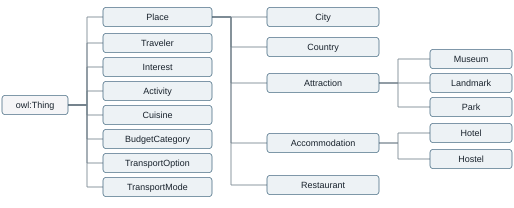
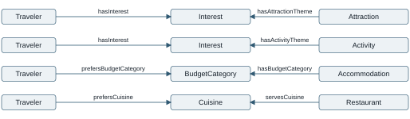

# Travel Assistant Ontology

Assignment 1 Ontology Modeling

Yazdan ZandiyeVakili | Student number 12642780

188.399 Introduction to Semantic Systems | TU Wien | 2 November 2026

## Application idea

The proposed application is a travel assistant for leisure city trips. It would help travelers choose attractions, activities, accommodation, restaurants, and transport options using their interests and preferences. The ontology developed for this assignment provides the vocabulary and constraints for a future knowledge graph. It contains 18 domain classes and 26 properties, comprising 13 object properties and 13 datatype properties. The application itself has not been implemented, and no domain individuals have been added.

The semantic benefit is that preferences and travel options can refer to shared concepts. A traveler and a museum could be linked to the same interest, allowing a future query to find relevant attractions in a selected city. Subclass relationships also allow museums to be treated as attractions and hotels as accommodation. The scope covers descriptive information and broad budget categories. Bookings, payments, visa advice, live availability, and real-time prices are excluded. Transport access represents a recorded connection to an attraction; it does not calculate a route.

## Competency questions

1. Which attractions are located in a selected city?
2. Which attractions in that city match the traveler's interests?
3. Which activities are available in that city and match those interests?
4. Which accommodation options in that city match the traveler's budget category?
5. Which hotels or hostels are located in the selected city?
6. Which restaurants in that city serve a preferred cuisine?
7. Which transport options provide access to a selected attraction?
8. Which cities offer attractions matching the traveler's interests?

Here, interest matching means sharing at least one *Interest* individual. Budget and cuisine matching use the same category or cuisine individual on both sides. Budget categories have no price thresholds or ordering in this model. An activity being available means it takes place in the city, without implying date-specific availability. Geographic coverage and data collection remain for later work.

<!-- pagebreak -->

## Ontology development

**1 Scope.** The domain was narrowed to city-trip planning. Destinations, places to visit, accommodation, food, transport, and preferences were retained. This scope guided the vocabulary and kept transaction processing and information requiring live updates outside the ontology.

**2 Questions.** Eight competency questions were formulated before implementation. Each identifies a required connection, such as linking accommodation to a city and to the budget category preferred by a traveler.

**3 Classes.** Eighteen classes were organized into the hierarchy in Figure 1. *Place* groups physical locations and geographic areas. *Traveler*, *Interest*, *Activity*, and the other top-level classes remain directly under *owl:Thing* because a more specific common parent was unnecessary. Location is represented by properties rather than subclass relationships.

**4 Properties.** Object properties connect individuals, for example *locatedInCity* from *Place* to *City*. Datatype properties record names, addresses, websites, country and currency codes, time zones, activity durations, transport names and route identifiers, vegetarian options, and check-in/out times. Domains and ranges were specified for every property.

**5 *RDF* and *RDFS* foundation.** The vocabulary was built from scratch using the namespace *https://example.org/travel-assistant#* and saved in *Turtle* with an *.owl* extension. The initial model used subclass, domain, and range declarations with English labels and comments. *OWL* entity declarations identified class and property types. *Codex* generated the *Turtle* file from the agreed design; it was subsequently inspected in *Protégé*. The baseline was preserved separately.

**6 *OWL* enrichment.** Five *OWL* construct kinds were added to express disjointness, inverse relationships, city restrictions, and a functional boolean property. The inverse *containsPlace* increased the object-property count from 12 to 13. Table 1 gives the implemented axioms and their purposes.

**7 Validation.** *RDFLib* 7.6.0 parsed the enriched ontology as 222 triples; structural, annotation, and round-trip checks passed. The file loaded in *Protégé* 5.6.9, where *HermiT* 1.4.3.456 found no inconsistency or unsatisfiable named class. All eight questions were mapped to compatible class/property patterns. No instance-level query answers were tested.

*Figure 1. All 18 domain classes and owl:Thing. Lines connect a parent to its subclasses from left to right; they represent rdfs:subClassOf, not location. Other restrictions and disjointness are omitted.*

<!-- pagebreak -->

## Relationships supporting the questions

*Figure 2. Selected preference relationships. Boxes denote classes; arrows describe links between their instances, not assertions between class resources. Location and transport properties are omitted.*

CQ-02 joins *hasInterest* and *hasAttractionTheme* through a shared *Interest*, filtering by *locatedInCity*. CQ-07 follows *providesAccessTo* from *TransportOption* to *Attraction*. *TransportMode* describes the option's type. A future query layer would perform these joins.

## OWL features and examples

The examples below use *Manchester-style* notation, with namespace prefixes omitted for domain terms.

| Construct | Implemented example | Meaning |
|---|---|---|
| Disjoint classes | *Traveler* DisjointWith *Place* | An individual cannot be both a traveler and a place. |
| Inverse properties | *locatedInCity* InverseOf *containsPlace* | A place's city link entails the city's reverse link, and conversely. |
| Existential restriction | *Attraction* SubClassOf *locatedInCity* some *City* | Every attraction is located in at least one city. |
| Qualified exact cardinality | *Accommodation* SubClassOf *locatedInCity* exactly 1 *City* | Every accommodation is located in exactly one city. |
| Functional datatype property | *hasVegetarianOptions* Characteristics: Functional; Range: *xsd:boolean* | At most one boolean value is permitted. Asserting both true and false is contradictory. |

*Table 1. Five OWL construct kinds enriching the initial RDF(S) model.*

The city restrictions simplify the city-trip scope and apply to subclasses. Under the open-world assumption, a required city need not be named; a missing vegetarian value means unknown. Different identifiers need not denote distinct cities, so two city names alone do not prove a cardinality violation. Domains and ranges support type inference, not mandatory-field validation.

## Reflection

The process highlighted the distinction between class hierarchies, individual relationships, and their constraints. Logical consistency and question coverage were checked separately. Useful answers still require populated data with consistent budget assignments and transport-access criteria.

## AI usage

I created the ontology and made the modeling decisions. I used *Protégé* to inspect and validate the *OWL* file. AI assisted with generating the initial *Turtle* serialization from my decisions and with writing and formatting this report.
